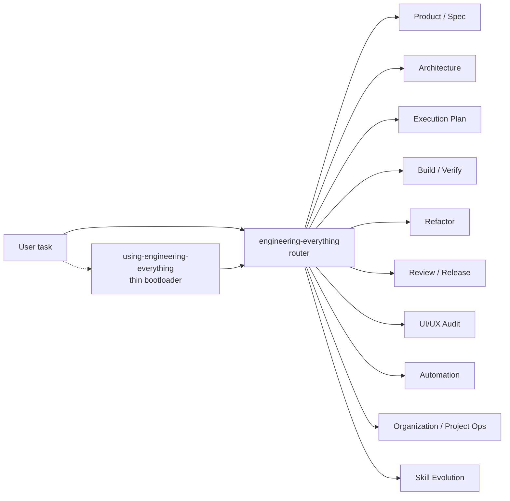

# Engineering Everything（工程化万物）

用工程思维路由创造型任务：先判断需求、架构、执行、验证、发布和沉淀路径，再让 agent 动手。

- 当前版本：`0.17.0`
- Package ID：`engineering-everything`
- License：`UNLICENSED`

## What It Is

Engineering Everything 是一个 plugin-first Skill library。它不是单个大 prompt，也不是把所有规则塞进一个入口；运行时入口只在 `skills/*/SKILL.md` 下：

- `$using-engineering-everything`：推荐入口。很薄的 bootloader，只管要不要进入、会话怎么接上，然后交给主路由。
- `$engineering-everything`：主路由，也是唯一要先读的文件：路由表、不可突破的规则、对人表达规则都在这里，判断完直接进子 Skill。
- `engineering-*` 子 Skill：分别处理产品定义、架构、执行规划、构建验证、重构、review/release、UI/UX 界面评判、自动化、组织系统、项目接手和 Skill 自进化。

它解决的问题很直接：agent 不应该在需求未清、数据源未明、验证门禁不存在、旧项目未盘点时就开始写代码或搭架构。

从 `0.14.0` 起，它也是团队协作的**开发 SkillOS**：创始人或业务方给一句话，负责人和 Agent 把它想清楚、做出来、由另一个人确认做对了再交付，值得记的经验沉淀下来，让下一次同类任务更少依赖创始人。见下方 [Delivery Gates](#delivery-gates开发-skillos)。

## Quick Start

```bash
git clone https://github.com/HaodiFan/engineering-everything.git
cd engineering-everything
python3 scripts/install.py --target codex
```

新会话中使用：

```text
$using-engineering-everything

我想做一个电商管理系统。先判断工程路由，再告诉我现在应该先问什么、选什么、写什么。
```

已明确要直达主路由时：

```text
$engineering-everything

review 这个 PR，判断能不能 merge。
```

## How It Routes



从入口到开始干活只走两跳：主路由 → 子 Skill。开工前不预读参考文件；每个子 Skill 的参考文件都写明“什么时候读”，`scripts/skill_doctor.py` 会检查入口没有预读、参考文件都有读取条件、主路由的表和 `data/routes.yaml` 一致。

路由事实源是 `data/routes.yaml`。输出契约事实源是 `references/output-contracts.md`。不要在 README 或 Skill 正文里维护第二套路由表或输出模板。

## 评审工具

- **脚本驱动聚类维度评审与 HTML 报告**（`scripts/review_runner.py` + `scripts/review_report_html.py` + `data/review_pipeline.json` + `references/review-rules.md`）：默认基线聚类为 **6 个正交 Review 维度、48 条稳定编号原子规则（`RV-BASE-01`..`RV-REL-03`，含 10 条逐项坏味道 `RV-SMELL-01`..`10`；UI 维度另接 70 条 `UX-*`）**，支持通过 `$EE_PRIVATE_ASSETS`、项目 `.evolution/` 与 CLI `--overlay` 动态叠加或裁剪阶段/维度/规则（`schemas/review-overlay.schema.json`），全程自动落盘过程日志（`events.jsonl` / `progress.log`）并默认产出按维度讲清优化点的可视化 **`report.html`**（+ `report.md`），缺任一必检规则即拒收。协议见 `references/review-pipeline.md`。
- **代码评审**（`engineering-review-release`）：问题先行，行为正确性与回归风险优先，再查坏味道与可维护性（联动 `references/refactoring-rules.md`）、测试缺口与密钥风险。React 项目在 `code_quality` 维度内自动激活开源 [React Doctor](https://github.com/millionco/react-doctor) 只扫改动范围，默认不上传遥测、不做第三方供应链扫描；工具结果当线索重定级。用法见 `references/react-doctor.md`。
- **界面评判**（`engineering-ui-ux-audit`）：按 70 条编号规则逐条判断 通过 / 不通过 / 不适用 / 未验证，含陌生语言自解释检查（`UX-VIS-09`）与 Bombadil 前置状态探索；不打审美分，截图证明不了的一律标未验证。团队交付时作为 Phase 2 `ui_ux_experience` 维度交回评审汇总。

## Delivery Gates（开发 SkillOS）

团队交付一件事，只在三个时刻停下来：

| 时刻 | 要回答的问题 | 负责的 Skill |
|---|---|---|
| 开工前：想清楚 | 帮谁解决什么问题？做成了是什么样子？要不要找人拍板？ | `engineering-product-definition`（+ `engineering-execution-planning`） |
| 交付前：确认做对了 | 业务问题解决了吗？功能、体验、工程底线、上线准备都到位了吗？ | `engineering-review-release` |
| 交付后：学到了什么 | 这次的纠偏值得记下来吗？记到哪里？ | `engineering-skill-evolution` |

- 先业务后技术；事情越小流程越轻；对人先给结论、只说相关的事（`references/output-contracts.md` 的“对人表达”）。
- 方法：`references/delivery-gates.md`；验证方法目录（业务验证、TLA+/TLC、Bombadil、Pact、变异测试、上线准备等，含什么时候用和局限）：`references/verification-methods.md`。
- 需要留档或自动检查时：`schemas/` 下的需求卡、证据包、拍板单、沉淀候选、项目检查配置；`python3 scripts/gate_check.py check <证据包.json>` 检查证据是否齐全。
- 本仓库只放通用方法。公司的审美案例、需求样例、项目检查配置放在项目 `.evolution/` 或 `EE_PRIVATE_ASSETS` 指向的私有仓库。

## Common Entrypoints

| 你要做什么 | 推荐入口 | 命中能力 |
|---|---|---|
| 模糊想法、需求、PRD | `/spec` `/define` | `engineering-product-definition` |
| 技术栈、架构、从 0 搭项目 | `/arch` `/new-project` | `engineering-architecture-design` |
| 接手旧项目、代码盘点 | `/handover` `/audit` | `engineering-project-inheritance` |
| 功能拆解、implementation plan | `/plan` `/split` | `engineering-execution-planning` |
| 实现、修 bug、迁移 | `/build` `/fix` | `engineering-build-verify` |
| 重构、清理、模块化 | `/refactor` `/cleanup` | `engineering-refactoring` |
| 测试、review、release | `/test` `/review` `/ship` | `engineering-review-release` |
| RPA、OCR、CV、LLM、数据自动化 | `/automation` `/rpa` `/ocr` `/llm` | `engineering-automation-playbooks` |
| 面试、入职、组织、SOP、非软件项目 | `/interview` `/onboard` `/org` `/estimate` | `engineering-organization-systems` |
| lesson、pattern、自进化 | `/learn` `/lesson` `/self-evolve` | `engineering-skill-evolution` |

用户说“不对 / 不是 / 这部分好乱 / 你没有参考”时，不默认切到 `/learn`。agent 必须先修正当前任务，再询问是否创建 GitHub lesson issue。

## Expected Output

规划类输出至少要回答：

- `工程路由`
- `当前阶段`
- `项目形态`
- `参考依据`
- `缺失内容`
- `下一步 3 个动作`
- `验证门禁`
- `停止条件`

执行类收尾必须说明：变更文件、已运行验证、未运行检查及原因、剩余风险。完整模板见 `references/output-contracts.md`。

## Installation

默认安装到 Codex：

```bash
python3 scripts/install.py --target codex
```

安装到本地 Agents：

```bash
python3 scripts/install.py --target agents
```

同时安装到 Codex 和 Agents：

```bash
python3 scripts/install.py --target both
```

安装到 Claude Code（`~/.claude/skills`），或三个宿主全部安装：

```bash
python3 scripts/install.py --target claude
python3 scripts/install.py --target all
```

查看、重建 symlink、卸载：

```bash
python3 scripts/install.py list --target both
python3 scripts/install.py relink --target both
python3 scripts/install.py uninstall --target both
```

安装后会把每个 runtime skill 链接到对应 `skills/*` 子目录，例如：

- `~/.codex/skills/using-engineering-everything`
- `~/.codex/skills/engineering-everything`
- `~/.codex/skills/engineering-project-inheritance`
- `~/.agents/skills/using-engineering-everything`
- `~/.agents/skills/engineering-everything`
- `~/.agents/skills/engineering-project-inheritance`

### 启动时检查新版本

每次新开会话时检查两件事：本仓库在 GitHub `main` 上有没有新版本，EvoZeus 当前通道有没有新版本。两边都是最新的时候不出声；有新版本时在会话开头提示一句，并告诉你怎么升级。检查**不会自己拉代码或改安装**：EE 要你自己 `git pull --ff-only`，EvoZeus 本身会在会话启动时自动升级。网络不通时也不出声，同一小时内只联网查一次。

```bash
python3 scripts/update_check.py install-hook --target both    # 写入 Claude / Codex 的 SessionStart hook
python3 scripts/update_check.py check --force                 # 手动查一次
python3 scripts/update_check.py uninstall-hook --target both
```

Codex 第一次遇到新 hook 时会要求你在 hooks 界面里批准。临时关闭：`EE_UPDATE_CHECK=0`；调整频率：`EE_UPDATE_CHECK_INTERVAL=<秒>`。

旧式整包安装已经退役；`--layout legacy` 会被拒绝。当前结构是 plugin-first / library layout，运行时入口只来自 `skills/*/SKILL.md`。

## Repository Layout

```text
engineering-everything/
├── .codex-plugin/
│   └── plugin.json
├── agents/
│   └── openai.yaml
├── data/
│   ├── routes.yaml
│   └── reference_distribution.yaml
├── docs/
│   ├── testing.md
│   └── designs/
├── evals/
│   └── scenarios/
├── references/
├── scripts/
└── skills/
    ├── using-engineering-everything/
    ├── engineering-everything/
    ├── engineering-project-inheritance/
    └── engineering-*/
```

Key files:

| File | Purpose |
|---|---|
| `.codex-plugin/plugin.json` | Plugin manifest；声明 `"skills": "./skills/"`，也是 package version 事实源。 |
| `skills/using-engineering-everything/SKILL.md` | Bootloader entrypoint. |
| `skills/engineering-everything/SKILL.md` | Kernel router entrypoint. |
| `skills/engineering-project-inheritance/SKILL.md` | 旧项目接手、盘点、继续迭代入口。 |
| `data/routes.yaml` | Machine-readable route contract. |
| `data/reference_distribution.yaml` | Root reference 到 runtime reference 副本的分发事实源。 |
| `references/output-contracts.md` | 规划、执行、review、eval 输出契约。 |
| `references/psps-framework.md` | Persona / Scenario / Pain / Solution Surface 框架。 |
| `references/refactoring-rules.md` | 行为保持型重构规则。 |
| `references/self-evolution-harness.md` | Lesson issue、pattern、自进化和发布门禁。 |
| `references/delivery-gates.md` | 团队交付的三个关口、改动大小、什么时候找人拍板、公司私有内容的边界。 |
| `references/verification-methods.md` | Gate 2 各步骤的成熟验证方法、触发条件与局限。 |
| `schemas/*.schema.json` | 需求卡、Evidence Package、升级单、进化候选、lesson、pattern 的结构。 |
| `evals/scenarios/*.md` | 行为 eval 场景。 |
| `docs/testing.md` | 本地验证和 release gate 说明。 |

## Tooling

| Script | Purpose |
|---|---|
| `scripts/install.py` | 安装、relink、uninstall、list runtime skills。 |
| `scripts/skill_doctor.py` | 检查 plugin/library contract、route、reference、eval、README 和版本一致性。 |
| `scripts/sync_references.py` | 检查 root reference 与 runtime copies 是否 drift。 |
| `scripts/eval_scenarios.py` | 校验行为 eval scenario schema。 |
| `scripts/self_evolve.py` | 检查自进化 harness、GitHub/source contract 和安装副本。 |
| `scripts/lesson.py` | 校验 lesson/pattern 结构。 |
| `scripts/gate_check.py` | 机检 Evidence Package 是否可发布；`template` 子命令生成空包。 |
| `scripts/review_runner.py` | 脚本驱动的开发后评审编排器：侦测范围、合并叠加配置、动态拼接并发维度 Prompt、记录过程日志、校验落盘、联动 `gate_check.py` 总决并生成 `report.html` 及 `recheck` 增量复审。 |
| `scripts/review_report_html.py` | 零依赖 Review HTML 可视化报告渲染器：按 6 维度清晰呈现结论、待优化动作卡片、缺口、逐条 `RV-*` 规则明细与过程时间线。 |
| `scripts/update_check.py` | 检查 EE 和 EvoZeus 在 GitHub 上是否有新版本；可装成会话启动 hook（只提示，不自动更新）。 |

常用验证：

```bash
python3 scripts/skill_doctor.py --json
python3 scripts/self_evolve.py check --json
python3 scripts/eval_scenarios.py validate --json
python3 scripts/sync_references.py --check --json
python3 -m unittest discover -s tests
```

## Development Rules

- 不写第二套路由事实源：改路由先改 `data/routes.yaml`。
- 不复制输出模板：完整模板只放在 `references/output-contracts.md`。
- 不手改 runtime reference copy：先改 root `references/`，再用 `data/reference_distribution.yaml` 和 `scripts/sync_references.py` 检查。
- 改 Skill、route、reference、install 或 release contract 后，至少跑 `scripts/skill_doctor.py` 和 `scripts/self_evolve.py check`。
- 涉及 GitHub issue、push、tag、release 时，加跑 `scripts/self_evolve.py doctor`。

## Status

- 当前版本：`0.17.0`
- GitHub repo：`HaodiFan/engineering-everything`
- Runtime layout：plugin-first, `skills/*/SKILL.md`
- Latest release：`v0.17.0`（脚本驱动 6 维度评审链路 + HTML 可视化优化报告 + Bombadil 显式接入 + 陌生语言自解释 `UX-VIS-09`）
- License：`UNLICENSED`

## Uninstall

```bash
python3 scripts/install.py uninstall --target both
```

或手动删除：

```bash
rm -rf ~/.codex/skills/using-engineering-everything
rm -rf ~/.codex/skills/engineering-everything
rm -rf ~/.agents/skills/using-engineering-everything
rm -rf ~/.agents/skills/engineering-everything
```

卸载只删除 runtime skill 链接或副本，不会删除你在项目中创建的代码、文档或业务产物。
